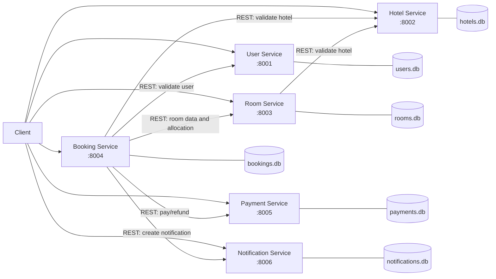

# Архітектура системи

Документ фіксує фінальну реалізовану архітектуру. Booking Service координує successful create, bounded payment retry, compensation після часткового успіху та idempotent cancellation. Phase 8 додає лише real-HTTP demo та integration verification; бізнес-архітектура не змінюється. Notification є best-effort і не змінює досягнутий core state.

Atomic hold відкриває `BEGIN IMMEDIATE` до availability check і вставляє `HELD` у тій самій transaction. Це змушує другого SQLite writer дочекатися commit і повторити overlap check на актуальному стані. Python process lock не використовується, бо не гарантує correctness між різними processes/instances.

## Decomposition і межі

Система складається рівно із шести бізнес-мікросервісів:

| Сервіс | Межа відповідальності | Власне сховище |
|---|---|---|
| User Service | Профіль і active-стан користувача | `users.db` |
| Hotel Service | Дані та active-стан готелю | `hotels.db` |
| Room Service | Кімнати, ціни, пошук доступності, hold/confirm/release | `rooms.db` |
| Booking Service | Snapshot бронювання та керування Saga | `bookings.db` |
| Payment Service | Payment state, charge simulation і refund | `payments.db` |
| Notification Service | Створення, симуляція відправлення і читання повідомлень | `notifications.db` |

Hotel Service не володіє кімнатами. Room Service зберігає тільки `hotel_id`, але не копію об’єкта Hotel. Booking Service зберігає історичний snapshot, який не стає source of truth для Room або Hotel.

## Системна схема



Стрілка REST означає виклик публічного API, а не доступ до чужої БД. Прямі бізнес-виклики між іншими парами сервісів не передбачені.

## Data ownership

Діє безумовне правило **NO CROSS-DATABASE ACCESS**:

1. Кожна SQLite DB належить рівно одному сервісу.
2. Лише власник виконує SQL до цієї DB.
3. Foreign key між базами не створюються. Ідентифікатори інших bounded contexts (`user_id`, `hotel_id`, `room_id`, `booking_id`) є логічними посиланнями.
4. Актуальність зовнішнього об’єкта перевіряється через REST API його власника.

Наприклад, Booking Service отримує користувача через User Service, а Room Service перевіряє готель через Hotel Service. Вони не відкривають `users.db` чи `hotels.db` напряму.

## Комунікація та залежності

Міжсервісна взаємодія має бути синхронною REST-взаємодією через HTTPX. User, Hotel, Payment і Notification Services не мають бізнес-залежностей від інших сервісів. Room Service залежить від Hotel Service. Booking Service залежить від усіх інших п’яти сервісів.

Booking Service координує distributed workflow, але не отримує права змінювати чужий стан напряму. Кожна операція виконується локально власником даних; узгодженість досягається Saga та compensation, а не distributed SQL transaction.

## Конфігурація середовища

Адреси залежностей не можна hardcode у Python. Docker Compose має передавати:

| Отримувач | Змінна | Значення в Compose network |
|---|---|---|
| Booking Service | `USER_SERVICE_URL` | `http://user-service:8000` |
| Booking Service | `HOTEL_SERVICE_URL` | `http://hotel-service:8000` |
| Booking Service | `ROOM_SERVICE_URL` | `http://room-service:8000` |
| Booking Service | `PAYMENT_SERVICE_URL` | `http://payment-service:8000` |
| Booking Service | `NOTIFICATION_SERVICE_URL` | `http://notification-service:8000` |
| Room Service | `HOTEL_SERVICE_URL` | `http://hotel-service:8000` |

Шляхи до власних SQLite-файлів можуть бути локальною конфігурацією сервісу, але не повинні вказувати на БД іншого сервісу.

## Docker-архітектура

Docker Compose має містити `user-service`, `hotel-service`, `room-service`, `booking-service`, `payment-service` і `notification-service`. Кожен має окремі build context, Dockerfile, container, requirements та volume/шлях для власної SQLite DB. Усі застосунки слухають `8000` усередині контейнера; зовнішні mappings — `8001:8000` … `8006:8000`.

`depends_on` доцільний для декларації залежностей Room → Hotel і Booking → решта сервісів, але він не є readiness check. Для демонстрації готовність перевіряється `GET /health`; кожна відповідь має форму:

```json
{
  "status": "ok",
  "service": "booking-service",
  "version": "1.0.0"
}
```

## Незмінні правила

- Booking Service — єдиний Saga Orchestrator.
- Room Service — єдиний власник availability та allocation logic; глобального `available=true/false` немає.
- Payment Service — єдиний власник payment state; payment creation і refund мають бути idempotent.
- Notification Service — єдиний власник notification history.
- `total_amount` розраховує backend із snapshot-ціни та кількості ночей; клієнт його не надсилає.
- Double booking запобігається атомарною транзакцією Room Service.
- Payment `FAILED` або вичерпаний retry після hold спричиняє release; після успішної compensation Booking переходить у `PAYMENT_FAILED`.
- Cancellation виконує refund і лише потім release до локального переходу Booking у `CANCELLED`; повтор для вже `CANCELLED` не викликає downstream services.
- Room reservation, Payment і Booking state є critical effects. Notification є secondary: її failure логується з `booking_id` і type, але не відкочує `CONFIRMED`, `PAYMENT_FAILED` або `CANCELLED`.
- Якщо compensating service повністю недоступний, Booking може залишитися `PENDING` як unresolved marker. Durable outbox, retry worker і reconciliation не входять у лабораторний scope.
- Кожен сервіс має `GET /health` і Swagger `/docs`.
- Downstream failure повертається контрольованим `503`, без Python traceback у відповіді.

## Що демонструє лабораторна

| Concept | Цільова реалізація |
|---|---|
| Microservice decomposition | 6 незалежних FastAPI services |
| Database per Service | 6 окремих SQLite databases |
| Data ownership | Відсутність cross-database access |
| REST communication | Синхронні виклики через HTTPX |
| Service configuration | URLs через environment variables |
| Containerization | Окремий Docker container на сервіс |
| Orchestration | Booking Service координує workflow |
| Saga | Create Booking і Cancellation flows |
| Compensation | Release allocation після payment failure |
| Idempotency | Один payment на `booking_id`, повторний refund без ефекту |
| Concurrency protection | `BEGIN IMMEDIATE` навколо check-and-insert allocation |
| Historical snapshot | Booking зберігає hotel/room/price на момент покупки |
| Fault handling | Контрольований `503` і compensation |
| Critical vs secondary effects | Room/Payment/Booking critical; Notification best-effort |
| Health checks | `GET /health` у всіх сервісах |
| API documentation | Swagger/OpenAPI від FastAPI |
| Business validation | Dates, capacity, active state, availability |
| Distributed workflow | Booking → User/Room/Hotel/Payment/Notification |
| Integration verification | Pytest live HTTP tests і rerunnable `scripts/demo.py` |
