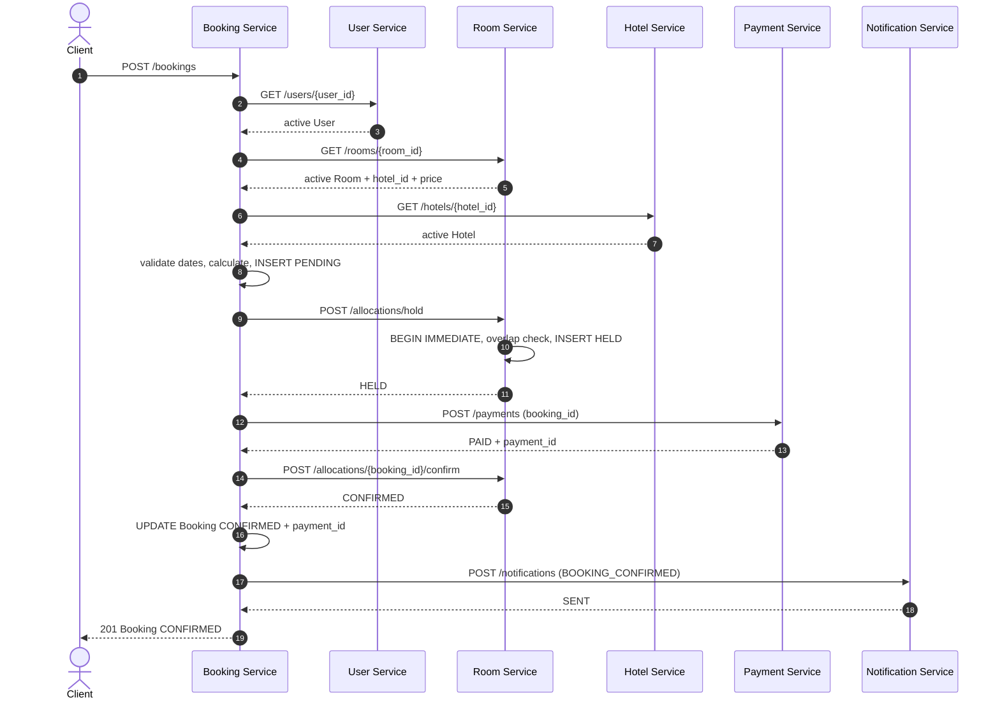
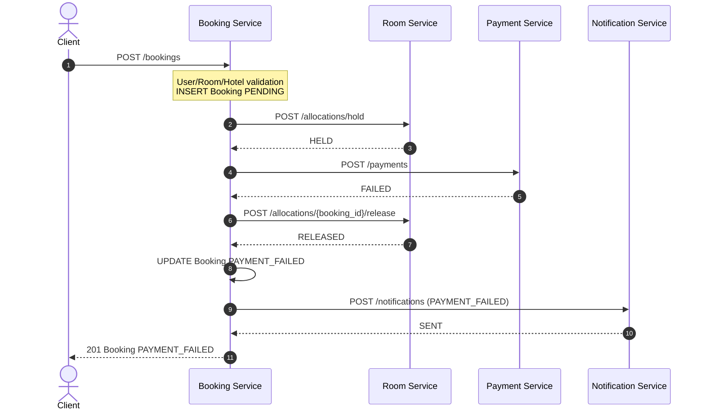
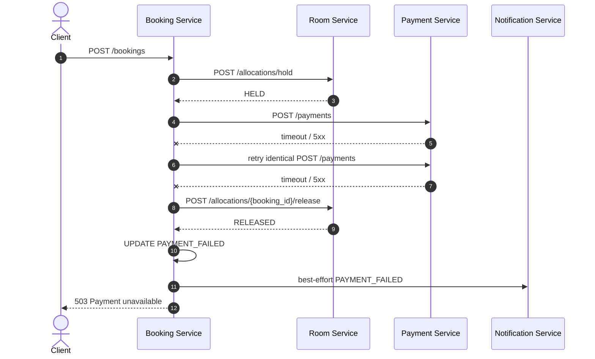
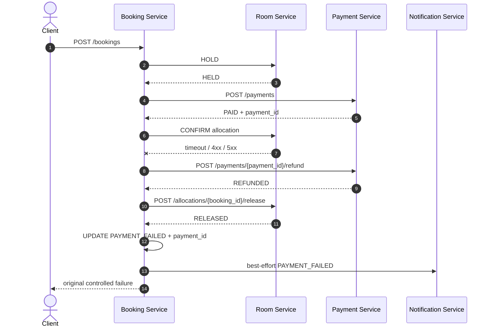
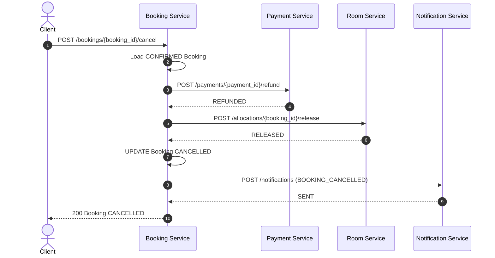

# Booking Saga

Booking Service є єдиним orchestrator. Він координує локальні transactions різних сервісів, але не створює distributed SQL transaction між `bookings.db`, `rooms.db`, `payments.db` і `notifications.db`.

> Стан Phase 7: successful create, payment-failure/network recovery, compensation після невдалого Room CONFIRM і Cancel Booking Saga реалізовані. Діаграми нижче описують actual workflows.

## Модель узгодженості

Кожен крок змінює стан лише через public API власника даних. Якщо наступний крок не вдається після часткового успіху, orchestrator викликає semantically opposite operation — compensation. Для створення бронювання такою операцією є `release` після `hold`; для cancellation безпека повторів забезпечується idempotent `refund` і `release`.

Critical effects — Room reservation, Payment і local Booking state. Notification є secondary best-effort effect: timeout, connection error або 5xx логується з `booking_id` і notification type, але не змінює вже досягнутий `CONFIRMED`, `PAYMENT_FAILED` чи `CANCELLED`.

Основні переходи:

```text
Booking:   PENDING → CONFIRMED → CANCELLED
                   ↘ PAYMENT_FAILED
Allocation: HELD → CONFIRMED → RELEASED
             └────────────────→ RELEASED
Payment:   PENDING → PAID → REFUNDED
                   ↘ FAILED
```

## Create Booking Saga: успішний сценарій

1. Прийняти тільки `user_id`, `room_id`, `check_in`, `check_out`.
2. Через User Service отримати User і перевірити `active`.
3. Через Room Service отримати Room, його `hotel_id`, number, type, capacity і current price; перевірити `active`.
4. Через Hotel Service отримати Hotel і перевірити `active`.
5. Перевірити `check_in < check_out`; розрахувати `nights` і `total_amount` на backend.
6. У локальній transaction створити Booking зі status `PENDING` та snapshot hotel/room/price.
7. Викликати `POST /allocations/hold`. Room Service атомарно перевіряє overlap і створює `HELD`.
8. Викликати `POST /payments` з `booking_id` як idempotency key.
9. Якщо Payment має status `PAID`, викликати confirm allocation.
10. У локальній transaction встановити Booking `CONFIRMED` і `payment_id`.
11. Передати user email та booking data в Notification Service для `BOOKING_CONFIRMED`.
12. Повернути Booking клієнту.



## Payment failure та compensation

Якщо Payment Service повертає payment зі status `FAILED`, Booking Service зобов’язаний:

1. викликати `POST /allocations/{booking_id}/release`;
2. перевести локальний Booking з `PENDING` у `PAYMENT_FAILED`;
3. за можливості створити `PAYMENT_FAILED` notification;
4. повернути клієнту Booking у фінальному `PAYMENT_FAILED`, не `CONFIRMED`.



Це ланцюжок `HOLD → PAYMENT FAILED → RELEASE`. Після compensation кімната знову бере участь у availability search.

## Network failures

Виклики HTTPX мають мати finite timeout. Downstream transport error перетворюється на контрольований `503 Service Unavailable`, наприклад `{"detail":"Payment service is unavailable"}`.

- До створення `PENDING` або hold: повернути `503`; чужого стану для компенсації немає.
- Definitive 4xx від Room HOLD означає, що allocation не створено: тимчасовий local `PENDING` видаляється, Payment не викликається.
- Transport failure Room HOLD є неоднозначним: orchestrator best-effort викликає release. Після `RELEASED`/`404` local `PENDING` видаляється; якщо release не підтверджено, `PENDING` лишається unresolved marker і клієнт отримує `503`.
- Payment Service недоступний після hold: `POST /payments` повторюється рівно один раз з ідентичним payload і `booking_id`. Якщо обидві спроби неуспішні, orchestrator викликає release, за підтвердженої compensation ставить `PAYMENT_FAILED` і повертає `503`.
- Відповідь Payment Service могла загубитися після фактичної оплати: bounded retry безпечний, бо Payment Service поверне existing result, не створюючи double charge.
- Відповідь confirm/release загублена: повторити operation за `booking_id`; transition має бути idempotent для вже досягнутого стану.
- Notification Service недоступний після core transaction: підтверджені payment/allocation не компенсуються лише через недоставлене навчальне повідомлення. Failure фіксується в логах, а Booking зберігає досягнутий core status.

Якщо сама compensation тимчасово неуспішна, Booking не можна позначати `CONFIRMED`. Помилка має бути явно залогована з `booking_id`; повтор workflow/операторська повторна спроба release має бути безпечною. Додавання broker або background job не входить у цей scope.



## Payment PAID, але Room CONFIRM не вдався

Після підтвердженого `PAID` compensation завжди починається з refund. Room release дозволений лише після `REFUNDED`, щоб номер не став доступним при неповернених коштах. Після обох підтверджених кроків Booking переходить у `PAYMENT_FAILED` зі справжнім `payment_id`. Якщо refund або наступний release недоступний, Booking лишається `PENDING` як unresolved marker.



## Cancel Booking Saga

Cancellation приймає Booking у `CONFIRMED` і виконує кроки в такому порядку:

1. Отримати пов’язаний `payment_id`.
2. Викликати idempotent `POST /payments/{payment_id}/refund`.
3. Після `REFUNDED` викликати idempotent release allocation за `booking_id`.
4. Після `RELEASED` локально встановити Booking `CANCELLED`.
5. Створити `BOOKING_CANCELLED` notification.



Якщо refund пройшов, але release response загублена або Room Service недоступний, повторна cancellation знову викликає refund (отримує existing `REFUNDED`) і повторює release. Booking переходить у `CANCELLED` лише після обох core-кроків. Якщо Booking вже `CANCELLED`, endpoint повертає поточний ресурс без другого refund.

```mermaid
sequenceDiagram
    autonumber
    actor C as Client
    participant B as Booking Service
    participant P as Payment Service
    participant R as Room Service

    C->>B: POST /bookings/{id}/cancel
    B->>P: refund
    P-->>B: REFUNDED
    B->>R: release
    R--xB: timeout
    B-->>C: 503; Booking remains CONFIRMED
    C->>B: retry POST /bookings/{id}/cancel
    B->>P: refund again
    P-->>B: same REFUNDED, refunded_at unchanged
    B->>R: release again
    R-->>B: RELEASED
    B->>B: UPDATE CANCELLED
    B-->>C: 200 Booking CANCELLED
```

## Idempotency contract

| Operation | Ключ | Поведінка повтору |
|---|---|---|
| Payment create | `payments.booking_id UNIQUE` | Той самий payload повертає existing Payment; інший payload — `409` |
| Refund | `payment_id` + status `REFUNDED` | Повертає existing `REFUNDED`, не змінює `refunded_at` |
| Allocation hold | `room_allocations.booking_id UNIQUE` | Identical `HELD`/`CONFIRMED` retry повертає existing; інший payload або `RELEASED` дає `409` |
| Allocation confirm | `booking_id` | Existing `CONFIRMED` повертається без нового side effect |
| Allocation release | `booking_id` | Existing `RELEASED` повертається без нового side effect |
| Booking cancellation | Booking status | Existing `CANCELLED` повертається без повторного workflow |

Ідемпотентність потрібна, бо timeout не повідомляє caller-у, чи downstream operation була виконана.

## Межа compensation

Saga не є distributed rollback. Коли refund/release service повністю недоступний, orchestrator не може чесно підтвердити компенсацію: Booking може залишитися `PENDING` (або `CONFIRMED` під час незавершеної cancellation) для безпечного повтору та операційного розбору. Production-рішення потребувало б durable outbox, retry worker, reconciliation process або workflow engine/message broker; вони свідомо не реалізовані в цій лабораторній.

## Захист від race condition

Availability search для UI є інформаційним і сам по собі не резервує номер. Authoritative check відбувається під час hold у Room Service:

```text
BEGIN IMMEDIATE
  SELECT overlapping allocations
  WHERE room_id = requested.room_id
    AND status IN ('HELD', 'CONFIRMED')
    AND check_in < requested.check_out
    AND check_out > requested.check_in

  if found: ROLLBACK and return 409
  else: INSERT allocation(status='HELD')
COMMIT
```

`BEGIN IMMEDIATE` серіалізує конкурентні writers до завершення check-and-insert. Тому два клієнти можуть одночасно побачити room у search, але лише один hold для overlapping dates завершиться успішно; другий отримає `409 Conflict`. Інтервали, де перший `check_out` дорівнює другому `check_in`, не перетинаються.
