# Тема

Проєктування та реалізація мікросервісної архітектури системи бронювання готелів.

# Мета

Ознайомитися з принципами мікросервісної архітектури та на практиці виконати декомпозицію системи бронювання готелів на незалежні сервіси; реалізувати для кожного сервісу власне сховище даних за підходом Database per Service, організувати REST-взаємодію між компонентами, контейнеризацію та спільний запуск через Docker Compose, керування розподіленим процесом бронювання за допомогою Saga, компенсаційні операції, захист від конкурентного подвійного бронювання, ідемпотентність і автоматизоване тестування системи.

# Хід роботи

На початку проєкт було поділено на шість предметно орієнтованих мікросервісів: User Service, Hotel Service, Room Service, Booking Service, Payment Service і Notification Service. Кожний сервіс оформлено як окремий FastAPI-застосунок із власними моделями, схемами, налаштуванням бази даних, залежностями та Dockerfile. Окремо виділено документацію, сценарій автоматичної демонстрації та набори модульних, API й інтеграційних тестів. Фактичну структуру завершеного проєкту наведено на рисунку 1.

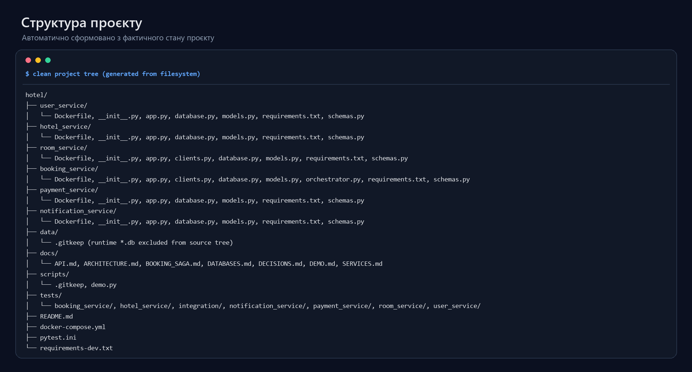

**Рисунок 1 – Структура проєкту Hotel Booking Microservices**

Взаємодію компонентів побудовано через синхронні REST-запити. Сервіси не звертаються безпосередньо до чужих баз даних: отримання або зміна зовнішнього стану відбувається тільки через API відповідного власника. Booking Service виконує роль Saga Orchestrator і координує User, Hotel, Room, Payment та Notification services, тоді як Room Service додатково перевіряє готель через Hotel Service. Реалізовані зв’язки та окремі сховища показано на рисунку 2.

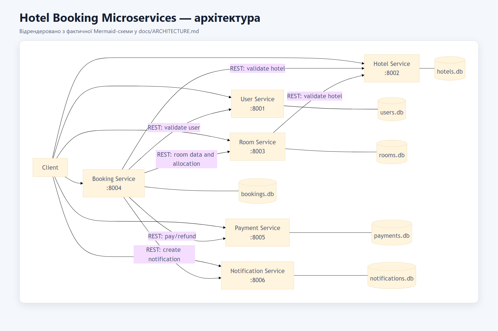

**Рисунок 2 – Архітектура та взаємодія мікросервісів системи**

Для відтворюваного локального розгортання використано Docker Compose. Після побудови образів було запущено шість окремих контейнерів і перевірено їхні health checks. Як видно з рисунка 3, усі контейнери перебувають у стані `running` і `healthy`. Усередині контейнера кожний застосунок слухає порт `8000`, а назовні сервіси опубліковані на портах `8001–8006`: User — `8001`, Hotel — `8002`, Room — `8003`, Booking — `8004`, Payment — `8005`, Notification — `8006`.

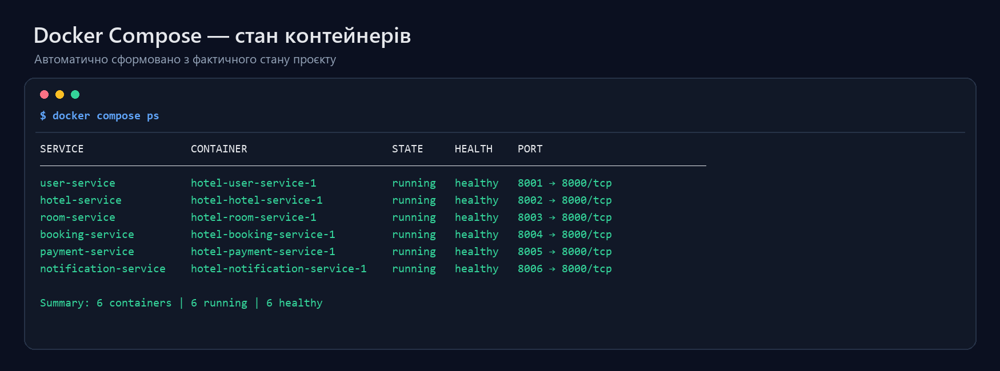

**Рисунок 3 – Стан контейнерів мікросервісів у Docker Compose**

Для ізоляції даних реалізовано підхід Database per Service. User Service володіє `users.db`, Hotel Service — `hotels.db`, Room Service — `rooms.db`, Booking Service — `bookings.db`, Payment Service — `payments.db`, а Notification Service — `notifications.db`. У `rooms.db` містяться таблиці `rooms` і `room_allocations`, оскільки саме Room Service є власником доступності номерів та їх розподілу за датами. Рисунок 4 підтверджує фактичну наявність шести незалежних SQLite-файлів і належних їм business tables; вміст runtime-записів на рисунку не відображається.

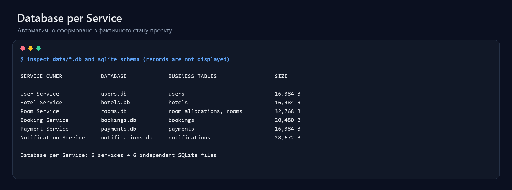

**Рисунок 4 – Окремі SQLite-бази даних мікросервісів**

FastAPI автоматично формує OpenAPI-специфікацію та інтерактивну Swagger-документацію. На рисунку 5 показано API Booking Service. Операція `POST /bookings` запускає Saga створення бронювання, read endpoints повертають окремі бронювання та списки, а `POST /bookings/{booking_id}/cancel` координує скасування. Таким чином, зовнішній клієнт працює з процесом бронювання через стабільний HTTP-контракт, не керуючи внутрішніми кроками інших сервісів.

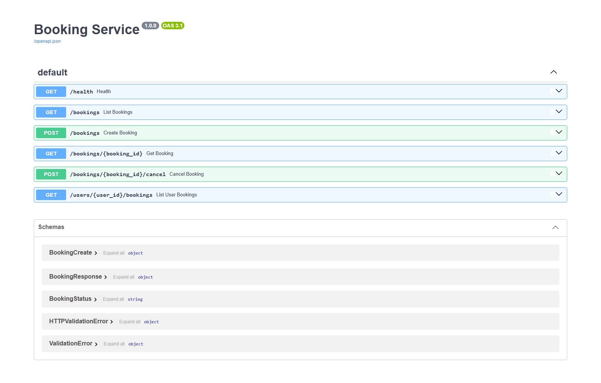

**Рисунок 5 – OpenAPI-документація Booking Service**

API Room Service, наведений на рисунку 6, поєднує базові операції з номерами, пошук доступних номерів через `GET /rooms/available` та життєвий цикл allocation. Окремі endpoints виконують `hold`, читання, `confirm` і `release`. Такий розподіл залишає перевірку зайнятості й зміну стану номера всередині сервісу, який володіє відповідними даними.

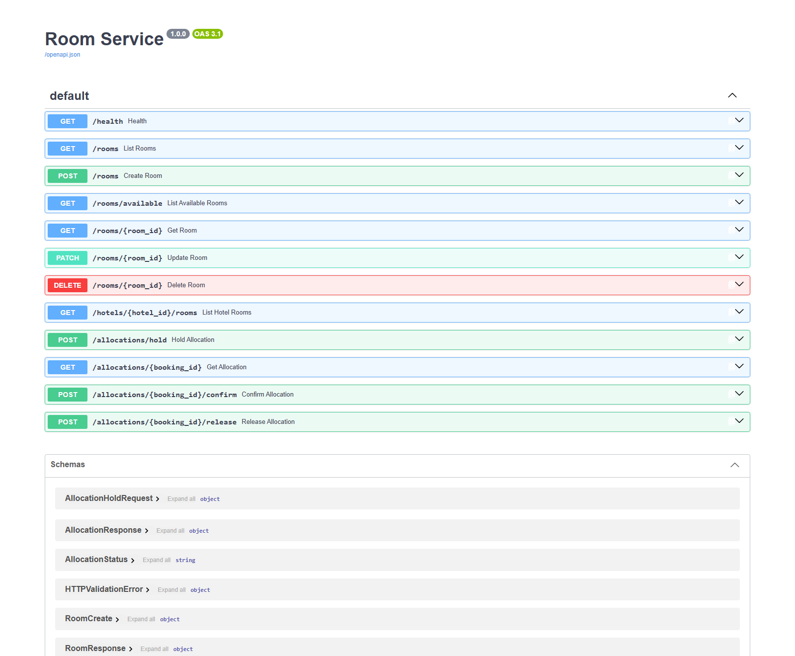

**Рисунок 6 – API доступності номерів і керування allocations**

Захист від подвійного бронювання реалізовано без process-local lock. У функції `hold_allocation` Room Service відкриває SQLite-транзакцію командою `BEGIN IMMEDIATE`, після чого в межах цієї самої транзакції перевіряє перетин активних `HELD` і `CONFIRMED` allocations та створює новий `HELD` запис. Канонічна умова перетину має вигляд `existing.check_in < requested.check_out AND existing.check_out > requested.check_in`. Фрагмент фактичної реалізації наведено на рисунку 7. Завдяки блокуванню SQLite другий конкурентний запит виконує перевірку вже на оновленому стані та у випадку конфлікту отримує `409 Conflict`.

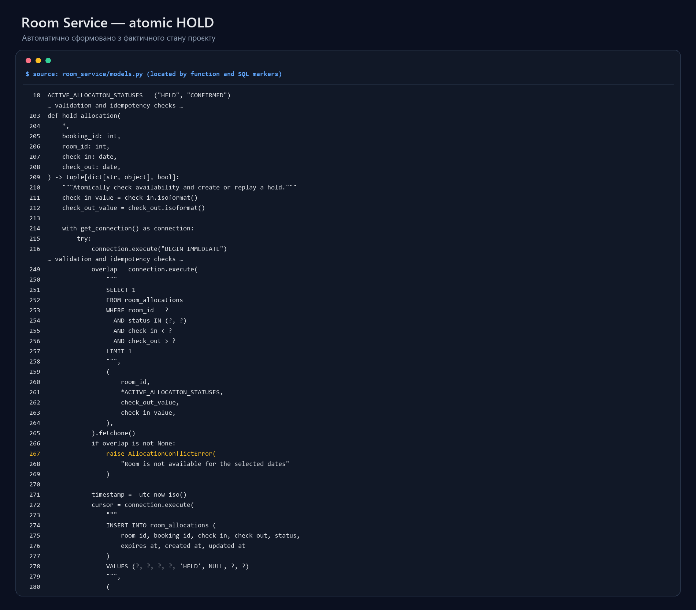

**Рисунок 7 – Реалізація атомарного захисту від подвійного бронювання**

Для перевірки повного робочого процесу було виконано `python scripts/demo.py`. На початку сценарій перевірив health усіх шести сервісів, створив користувача, готель і два номери, після чого підтвердив їх початкову доступність. Successful Booking Saga послідовно перевірила User, отримала дані Room і Hotel, створила локальний стан `PENDING`, виконала `HOLD`, створила симульований платіж зі станом `PAID`, підтвердила allocation, перевела Booking у `CONFIRMED` та створила `BOOKING_CONFIRMED` notification. Backend самостійно розрахував три ночі та суму `7500 UAH` за ціною `2500 UAH` за ніч. Фактичний output кроків 1–10 одного запуску наведено на рисунку 8.

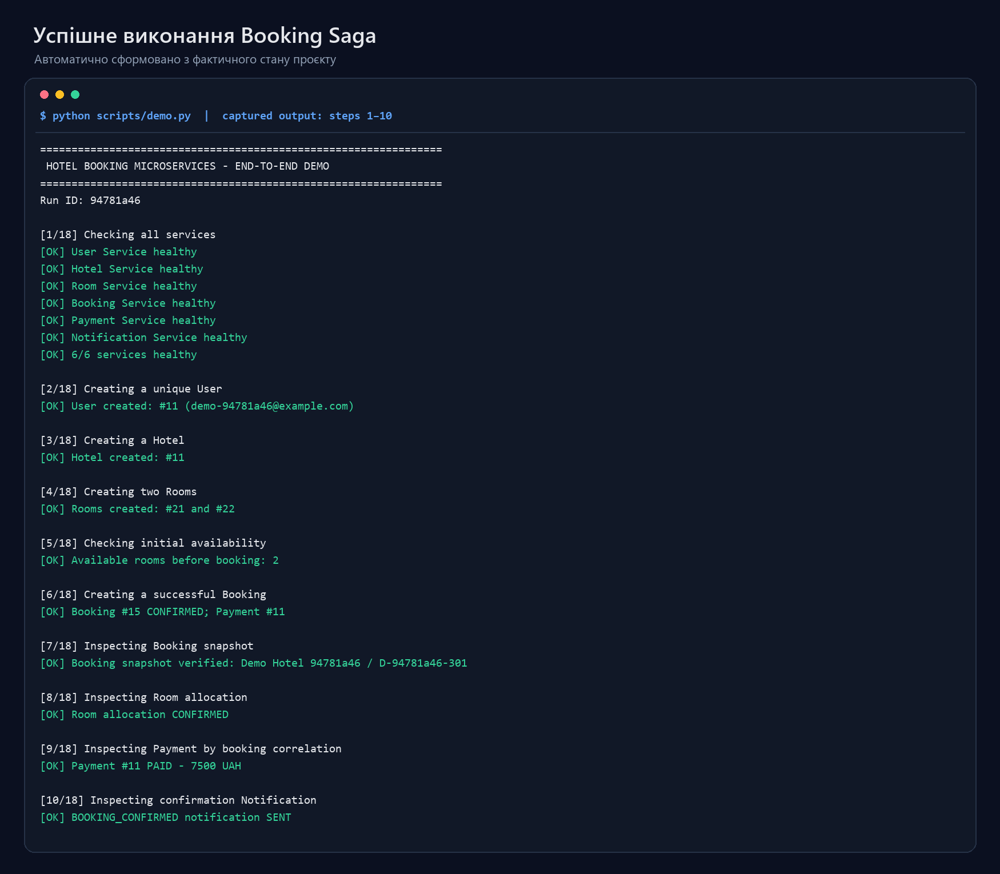

**Рисунок 8 – Успішне виконання Booking Saga**

Друга частина того самого demo підтвердила, що заброньований номер зникає з availability, а overlapping booking для цього номера повертає `409`, не змінюючи вже узгоджених станів Booking, Payment та allocation. Під час скасування Payment Service ідемпотентно перевів симульований платіж у `REFUNDED`, Room Service звільнив allocation зі станом `RELEASED`, Booking отримав стан `CANCELLED`, а Notification Service зберіг симульоване email-повідомлення `BOOKING_CANCELLED`. Після release номер знову став доступним. Повторне скасування не створило повторного refund або дубліката notification, що підтверджує ідемпотентність операції. Результати компенсаційного сценарію та фінальний статус `DEMO COMPLETED SUCCESSFULLY` показано на рисунку 9.

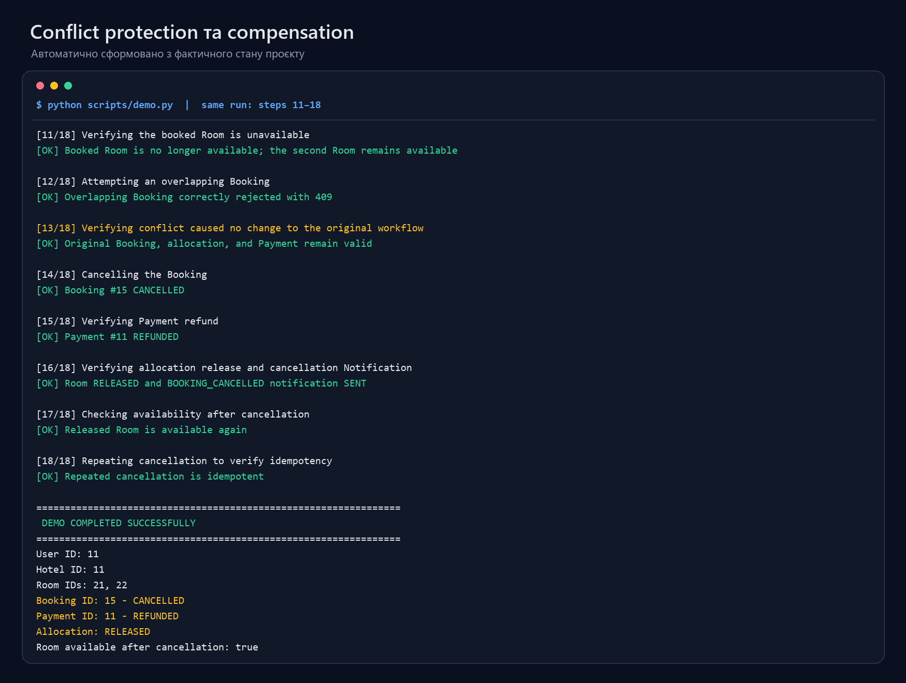

**Рисунок 9 – Захист від конфлікту та компенсаційний сценарій скасування**

Інтеграційні тести виконувалися через публічні HTTP endpoints реально запущених контейнерів. Вони перевіряють міжсервісний happy path, відхилення overlapping booking, refund/release/notification після скасування та відсутність повторних side effects. Фактичний результат, наведений на рисунку 10, становить `4 passed, 247 deselected` за `4.22 s`.

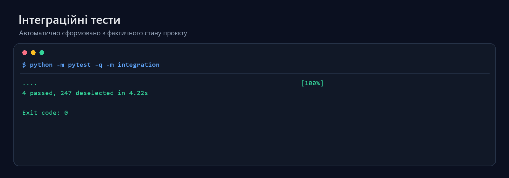

**Рисунок 10 – Результат виконання інтеграційних тестів**

На завершення було запущено повний набір автоматизованих тестів, який охоплює API окремих сервісів, бізнес-правила, Saga orchestration, compensation, availability, concurrency та live integration workflows. Як видно з рисунка 11, усі `251` тести успішно пройдено за `14.38 s`; пропущених або невдалих тестів у цьому запуску немає.

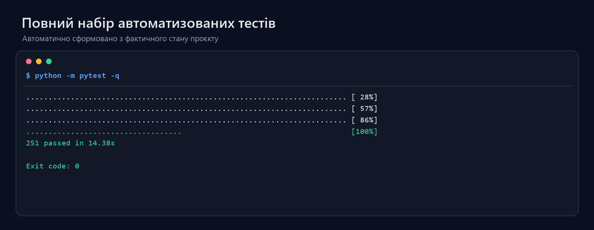

**Рисунок 11 – Результат повного автоматизованого тестування системи**

# Висновок

У ході лабораторної роботи розроблено навчальну систему бронювання готелів із шести мікросервісів. Для компонентів визначено окремі межі відповідальності та незалежне володіння SQLite-базами, а обмін даними організовано через REST API. Систему контейнеризовано й об’єднано за допомогою Docker Compose, а процес створення та скасування бронювання реалізовано як оркестрована Saga з компенсаційними діями.

Реалізація також містить транзакційний захист від конкурентного подвійного бронювання, ідемпотентні операції створення платежу, refund і cancellation, симуляцію платежів та email-повідомлень, end-to-end demo і повний набір автоматизованих тестів. Фактична демонстрація та результати `4` інтеграційних і `251` загальних тестів підтвердили узгоджену роботу компонентів. Отже, мету роботи досягнуто.
